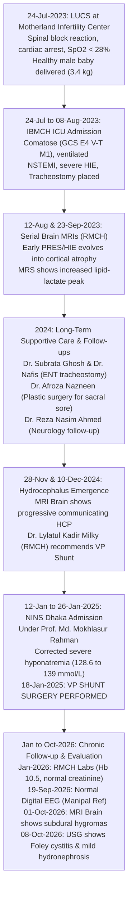

# Comprehensive Clinical Research & Medical Case Dossier

**Patient Legal Name:** Ms. Sanzida Khatun (Tonni)  
**Aliases in Records:** Sanjida / Sanzida / Tonni / Moss. Sanjida  
**Age:** 26–29 Years (DOB ~1997; BBA Student, Varendra University, Rajshahi)  
**Sex:** Female  
**Primary Facilities:**  
- National Institute of Neurosciences & Hospital (NINS), Dhaka  
- Rajshahi Medical College & Hospital (RMCH)  
- Islami Bank Medical College Hospital (IBMCH), Rajshahi  
- Popular Diagnostic Centre Ltd., Rajshahi  
- Motherland Infertility Center and Hospital, Rajshahi  
- Reference Consultations: Manipal Hospital (India), Sir Ganga Ram Hospital  
**Compiled Corpus:** 119 High-Resolution Medical Records (`IMG_9770.HEIC` – `IMG_9889.HEIC`)  
**Generated Resources:**  
- Consolidated Full Dossier PDF: [`All_Medical_Reports_Tonni.pdf`](file:///Users/fhb/Desktop/Medical%20Reports%20-%20Tonni/All_Medical_Reports_Tonni.pdf) (119 Pages)  
- Converted High-Res JPEGs: [`converted_jpg/`](file:///Users/fhb/Desktop/Medical%20Reports%20-%20Tonni/converted_jpg/)  
- Machine-Readable OCR Corpus: [`ocr_extracted_text.json`](file:///Users/fhb/Desktop/Medical%20Reports%20-%20Tonni/ocr_extracted_text.json)  

---

## 1. Executive Clinical Summary

Ms. Sanzida Khatun (known affectionately as Tonni), a previously healthy 26-year-old primigravida, suffered a catastrophic intraoperative/immediate post-operative cardio-respiratory collapse during a Lower Uterine Cesarean Section (LUCS) on **July 24, 2023** at Motherland Infertility Center, Rajshahi. 

Following a Subarachnoid Block (spinal anesthesia), she developed involuntary jerky movements, rapidly followed by generalized status-like convulsions, severe malignant hypertension ($180/120\text{ mmHg}$), acute cardiac compromise (NSTEMI), and profound respiratory failure with oxygen saturation dropping below $28\%$. Despite immediate emergency conversion to General Anesthesia, resuscitation, and delivery of a healthy male infant ($3.4\text{ kg}$), prolonged cerebral hypoperfusion resulted in **severe Hypoxic-Ischemic Encephalopathy (HIE)**.

Over the succeeding three years (2023–2026), the patient's course has been marked by:
1. **Severe Neurocognitive & Motor Impairment:** Spastic quadriparesis, anarthria/aphasia, inability to follow complex commands, and vegetative/minimally conscious state gradually improving to purposeful eye opening and localizing to stimuli.
2. **Communicating Hydrocephalus & VP Shunt Surgery:** Progressive cerebral volume loss and secondary ventriculomegaly culminated in formal neurosurgical intervention at the **National Institute of Neurosciences & Hospital (NINS), Dhaka**, where a **Ventriculoperitoneal (VP) Shunt was successfully placed on January 18, 2025**.
3. **Tracheostomy Dependency:** Maintained for airway protection and pulmonary toilet, managed longitudinally by ENT surgeons (Dr. Subrata Ghosh, Dr. A. A. M. Nafis). Decannulation was evaluated in late 2024 but deferred due to persistent swallowing dysfunction.
4. **Secondary Immobility & Catheter-Related Complications:**
   - **Bedsore / Sacral Pressure Ulcer:** Grade-II sacral ulcer managed by Plastic Surgery (Dr. Afroza Nazneen).
   - **Urological:** Chronic indwelling Foley catheterization resulting in chronic cystitis, recurrent UTIs (20–25 pus cells/HPF), and bilateral mild hydronephrosis ($L > R$) documented on ultrasound in October 2026.
   - **Musculoskeletal:** Bilateral foot drop and wrist drop managed with orthoses, splints, and ongoing physiotherapy.
5. **Latest Diagnostic Status (Late 2026):**
   - **Digital EEG (Sept 2026, Popular Diagnostic / Manipal Hospital Ref):** Normal awake EEG without epileptiform paroxysms.
   - **MRI Brain (Oct 2026):** Advanced ex-vacuo ventricular dilatation, prominent cerebral sulci, and bilateral fronto-parietal crescentic extra-axial fluid collections (chronic subdural hygromas).

---

## 2. Chronological Timeline of Medical Events



### Detailed Event Log

| Date | Institution & Attending Specialist | Clinical Record / Investigation | Significant Findings & Decisions | Key Report Files |
| :--- | :--- | :--- | :--- | :--- |
| **11-Jul-2023** | Rajshahi Diabetic Association Hospital | Antenatal Biochemical Screening | 75g OGTT: Fasting 4.3 mmol/L, 2-hr 6.8 mmol/L. Normal glucose tolerance prior to delivery. | `IMG_9830` |
| **24-Jul-2023** | Motherland Infertility Center & Hospital (Assoc. Prof. Dr. Fowzia Siddiqua, Dr. R.A. Joy) | **Emergency Operation & Index Event** | Full-term pregnancy undergoing elective LUCS. Immediately following Subarachnoid Block (SAB), developed severe lower extremity jerking and generalized convulsions. Converted to GA. Delivered male baby ($3.4\text{ kg}$, $4:50\text{ PM}$). Developed malignant hypertension ($180/120$), cardiac arrest/NSTEMI, acute pulmonary desaturation ($\text{SpO}_2 < 28\%$). Intubated, resuscitated, transferred immediately to IBMCH ICU. | `IMG_9791`, `IMG_9792`, `IMG_9793` |
| **24-Jul to 08-Aug-2023** | Islami Bank Medical College Hospital (IBMCH) ICU (Prof. Dr. Latifur Rahman Apu, Prof. Dr. Motiur Rahman, Dr. Reza Nasim Ahmed) | **ICU Admission & Resuscitation (15 Days)** | Admission GCS: $E4\ V\text{-}T\ M1$. Bilaterally fixed, dilated pupils. Central line (right subclavian) placed. Diagnosed with Hypoxic Ischemic Encephalopathy (HIE) secondary to perioperative arrest, NSTEMI, post-partum eclampsia vs toxic/hypersensitivity reaction. Tracheostomy performed. Managed on IV Tegalon (tigecycline), Avycef, Iracet (levetiracetam), Barbit (phenobarbital), Valex CR (valproate), IV Albumin. Discharged/transferred on 08-Aug-2023 with improved GCS $E4\ V\text{-}T\ M3$ to RMCH. | `IMG_9814`, `IMG_9815`, `IMG_9816`, `IMG_9817`, `IMG_9840`, `IMG_9841`, `IMG_9842` |
| **12-Aug-2023** | Rajshahi Medical College Hospital (RMCH) | **Early Post-Event Brain MRI** | Bilateral symmetrical altered signal in cortical/subcortical parieto-occipital lobes, thalami, and caudate heads with DWI restriction; right parietal cortical microbleed on GRE. Ventricles were normal. Impression: Posterior Reversible Encephalopathy Syndrome (PRES) / early acute-subacute hypoxic-ischemic insult. | `IMG_9824` |
| **23-Sep-2023** | RMCH Radiology & Imaging | **MRI Brain with MRS** | Diffuse bilateral signal alteration fronto-temporal lobes and splenium of corpus callosum. Loss of DWI restriction (pseudonormalization). **Beginning of progressive cerebral cortical atrophy and secondary ventricular enlargement**. MRS: Elevated lipid-lactate peak, reduced NAA and Choline (neuronal necrosis). | `IMG_9797`, `IMG_9798`, `IMG_9800`, `IMG_9803`, `IMG_9823` |
| **21-Jan-2024** | Islami Bank Hospital Rajshahi (Dr. Reza Nasim Ahmed) | Comprehensive Laboratory Follow-up | Hb $12.2\text{ g/dL}$, WBC $8,900/\mu\text{L}$, Platelets $291,000/\mu\text{L}$. **D-Dimer elevated at $0.74\ \mu\text{g/mL}$** ($<0.5$). S. Creatinine $0.60\text{ mg/dL}$, Albumin $3.8\text{ g/dL}$, normal electrolytes. | `IMG_9878`, `IMG_9879`, `IMG_9880` |
| **28-Feb-2024** | RMCH Plastic & Reconstructive Surgery (Dr. Afroza Nazneen Asha) | Burn & Wound Care Consultation | Tracheostomy site dressing + management of **Grade-II Sacral Bedsore**. Prescribed Tab. Roxiclav, Povisep and Betadine topical therapy, 2-hourly positional turning, dynamic ripple air mattress. | `IMG_9776` |
| **27-Nov-2024** | RMCH ENT & Head-Neck Surgery (Dr. A. A. M. Nafis) | Airway & Tracheostomy Evaluation | Tracheostomy tube in situ for $>1$ year. Evaluated for decannulation. Patient unable to comprehend/follow vocal commands; decannulation deferred pending flexible nasopharyngolaryngoscopy. | `IMG_9782` |
| **28-Nov-2024** | Popular Diagnostic Centre (Referred by Dr. Reza Nasim Ahmed) | **MRI Brain** | Marked progression: All cerebral ventricles moderately dilated; cerebellar folia widened; pontine and putaminal volume reduction. Multiple microbleeds on GRE in basal ganglia and fronto-parieto-occipital regions. Diagnosed: Communicating hydrocephalus secondary to volume loss vs Multisystem Atrophy (MSA-C features). | `IMG_9796`, `IMG_9821`, `IMG_9838` |
| **10-Dec-2024** | RMCH Department of Neurosurgery (Assoc. Prof. Dr. Md. Lylatul Kadir Milky) | **Neurosurgical Evaluation for Hydrocephalus** | Diagnosis: Progressive Hydrocephalus (HCP). GCS: $E4\ V1\ M4$. **Plan: Ventriculoperitoneal (VP) Shunt Insertion**. Prescribed Balancia (levetiracetam 500mg), Remtine (5mg), Neurolep (piracetam 800mg), Neuceet, Syrup Barbit, Inj. D-Rise 200,000 IU. Scheduled admission for shunt. | `IMG_9784`, `IMG_9822`, `IMG_9839` |
| **20-Dec-2024** | Specialist Consultation (Dr. Shamsuzzaman) | Neurological Review | Confirmed limb spasticity, GCS $E4\ M4\ V1$. Maintained Levetiracetam and phenobarbital. Advised immediate pre-shunt screening. | `IMG_9774` |
| **12-Jan to 26-Jan-2025** | **National Institute of Neurosciences & Hospital (NINS), Dhaka** (Prof. Md. Mokhlasur Rahman, Ward 7NS, Bed 19) | **Neurosurgical Admission & VP Shunt Surgery** | **14-Jan-2025 Labs:** Severe hyponatremia ($128.6\text{ mmol/L}$), urine pyuria (20–25 pus cells/HPF), mild anemia (Hb $9.6\text{ g/dL}$). Viral markers negative (HBsAg, HCV, HIV neg). Blood Group: O Positive.<br/>**18-Jan-2025: VP SHUNT SURGERY PERFORMED** under general anesthesia.<br/>**17-Jan-2025 Labs:** Hyponatremia successfully corrected to $139.0\text{ mmol/L}$ with saline feeds.<br/>**26-Jan-2025 Discharge:** Stable post-shunt. Prescribed Tab. Iracet, Tab. Valex CR, Cap. Cef-3, Cap. Aflox, Omenix, Bicozin. **Official recommendation: Transfer to CRP Center (Centre for the Rehabilitation of the Paralysed), Savar, Dhaka for intensive neuro-rehabilitation.** | `IMG_9806`–`IMG_9813`, `IMG_9835`, `IMG_9836` |
| **17-May-2025** | RMCH Neurosurgery (Dr. Md. Shamsul Huda Nipun) | Post-Shunt Neurosurgical Follow-up | Verified VP Shunt in situ and functional. Continued antiepileptics (Valex CR 500, Iracet). Referred to ENT for cannula maintenance. | `IMG_9773` |
| **29-Jan-2026** | RMCH Clinical Pathology | Indoor Laboratory Workup | Hb $10.5\text{ g/dL}$, ESR $25\text{ mm}$, WBC $5,800/\mu\text{L}$, Platelets $301,000/\mu\text{L}$, Random Blood Sugar $5.8\text{ mmol/L}$, S. Creatinine $0.60\text{ mg/dL}$. Overall hematological stability. | `IMG_9883`, `IMG_9884` |
| **17-19 Sep 2026** | Popular Diagnostic Centre (Referred by **Manipal Hospital**, Dr. Reza Nasim Ahmed) | **Digital Electroencephalogram (EEG)** | Standard 10–20 international system. Recorded vertex transients and sleep spindles during sleep; symmetric regular 8–13 Hz posterior dominant rhythm with eye-opening attenuation during wakefulness. **No epileptiform activity or paroxysmal spike-waves observed. Awake EEG reported as normal.** | `IMG_9855` |
| **01-Oct-2026** | Popular Diagnostic Centre (Assoc. Prof. Dr. Reza Nasim Ahmed) | **Latest Follow-Up Brain MRI** | Marked ex-vacuo ventricular dilatation with deep, prominent cerebral sulci (advanced cortical and subcortical atrophy). **New finding: Bilateral fronto-parietal crescentic extra-axial fluid collections** (hypointense T1, hyperintense T2/FLAIR), representing chronic subdural hygromas secondary to severe parenchymal volume loss. | `IMG_9849`, `IMG_9850`, `IMG_9851`, `IMG_9852` |
| **08-Oct-2026** | Ideal Diagnostic, CT Scan & MRI Centre (Dr. Md. Abdus Samad) | **Whole Abdomen 4D Color Ultrasound** | Liver, gallbladder (prior cholecystectomy), pancreas, and spleen normal. Urinary bladder wall thickened with balloon of Foley catheter in situ. **Bilateral mild hydronephrosis (Left > Right)** with pelvicalyceal dilatation. Suggestive of chronic catheter-related cystitis and urinary back-pressure. | `IMG_9853`, `IMG_9854` |

---

## 3. In-Depth Organ System & Diagnostic Analysis

### A. Central Nervous System (Neuro-Pathology & Imaging Evolution)

The patient’s neuroimaging records over 3+ years demonstrate the classic natural history of severe hypoxic-ischemic brain damage:

```
[24-Jul-2023: Cardiac Arrest / SpO2 < 28%]
                    │
                    ▼
[12-Aug-2023: MRI Brain]
- Cortical/subcortical hyperintensity on T2/FLAIR
- Restricted diffusion (DWI/ADC) in parieto-occipital lobes & basal ganglia
- Normal ventricles
                    │
                    ▼
[23-Sep-2023: MRI Brain + MRS]
- Loss of DWI restriction (pseudonormalization)
- Beginning of cerebral atrophy & early ventricular dilatation
- MRS: High lipid-lactate peak, marked reduction of NAA & Choline (neuronal necrosis)
                    │
                    ▼
[28-Nov-2024: MRI Brain]
- Progressive communicating hydrocephalus
- Multiple microbleeds on GRE-T2* across bilateral basal ganglia
- Cerebellar folial prominence & pontine volume reduction
                    │
                    ▼
[18-Jan-2025: NINS Dhaka VP Shunt Insertion]
                    │
                    ▼
[01-Oct-2026: Latest MRI Brain]
- Marked compensatory ventriculomegaly (ex-vacuo hydrocephalus)
- Bilateral fronto-parietal subdural hygromas (crescentic extra-axial collections)
- Normal EEG (19-Sep-2026): Demonstrates good electrographic seizure control
```

- **Neuro-Electrophysiology (EEG):** The normal awake digital EEG recorded in September 2026 is an exceptionally reassuring prognostic signal, confirming that her acute post-anoxic status epilepticus has resolved and that current dual antiepileptic therapy (Levetiracetam + Valproate) is successfully suppressing epileptiform activity.

### B. Respiratory & Airway Management

- **Tracheostomy:** In place since August 2023 (post-IBMCH ICU). Managed longitudinally by ENT specialists (Dr. Subrata Ghosh and Dr. A.A.M. Nafis).
- **Decannulation Assessment:** Evaluated on November 27, 2024. Decannulation was deferred because the patient was unable to follow commands, swallow safely, or protect her lower airway. She remains tracheostomy-dependent with humidified oxygen and regular inner cannula cleaning/suctioning.

### C. Renal, Electrolyte & Urological Profile

```
Serum Sodium Trajectory:
14-Jan-2025 (NINS Admission):  128.6 mmol/L  [Severe Hyponatremia]
          ▲ Treated with oral rehydration saline via NG tube
17-Jan-2025 (Pre-Op/Post-Saline): 139.0 mmol/L  [Normalized]

Renal Function Over Time:
21-Jan-2024:  Creatinine 0.60 mg/dL
14-Jan-2025:  Creatinine 0.39 mg/dL  (Low; indicates low muscle mass/bed-rest)
29-Jan-2026:  Creatinine 0.60 mg/dL
01-Oct-2026:  Creatinine 0.51 mg/dL
```

- **Urological Pathology (October 2026):**
  - Whole abdomen ultrasound (08-Oct-2026) revealed a **thickened urinary bladder wall with the Foley catheter balloon in situ** and **mild bilateral hydronephrosis ($L > R$)**.
  - This is a direct consequence of long-term Foley catheterization leading to chronic non-bacterial or bacterial cystitis, detrusor hyperreflexia/thickening, and secondary ureteral reflux/back-pressure.

### D. Hematological & Inflammatory Status

| Parameter | 21-Jan-2024 (IBH) | 14-Jan-2025 (NINS) | 29-Jan-2026 (RMCH) | Reference Range | Clinical Interpretation |
| :--- | :--- | :--- | :--- | :--- | :--- |
| **Hemoglobin** | $12.2\text{ g/dL}$ | $9.6\text{ g/dL}$ | $10.5\text{ g/dL}$ | $11.5 - 15.5$ | Mild-to-moderate microcytic anemia during hospitalization, currently stabilized at $10.5\text{ g/dL}$. |
| **ESR** | $20\text{ mm}$ | — | $25\text{ mm}$ | $0 - 20\text{ mm/1st hr}$ | Mild chronic non-specific inflammatory elevation. |
| **Total WBC** | $8,900/\mu\text{L}$ | $8,000/\mu\text{L}$ | $5,800/\mu\text{L}$ | $4,000 - 11,000$ | Consistently normal; no systemic leukocytosis. |
| **Platelets** | $291,000/\mu\text{L}$ | $275,000/\mu\text{L}$ | $301,000/\mu\text{L}$ | $150,000 - 450,000$ | Completely stable and within normal limits throughout. |
| **D-Dimer** | $0.74\ \mu\text{g/mL}$ | — | — | $<0.5\ \mu\text{g/mL}$ | Mildly elevated post-ICU, consistent with past venous stasis / inflammatory turnover. |
| **Urine Pus Cells** | Nil | $20 - 25/\text{HPF}$ | — | $0 - 5/\text{HPF}$ | Catheter-associated UTI treated during NINS stay. |

---

## 4. Master Medication History & Active Regimen

| Drug Name & Strength | Class & Pharmacological Mechanism | Prescribing Facility & Date | Indication | Current Status |
| :--- | :--- | :--- | :--- | :--- |
| **Tab. Iracet / Balancia 500 mg** | Levetiracetam (SV2A ligand) | NINS (Jan 2025) & RMCH | Broad-spectrum antiepileptic & post-anoxic seizure prevention | **Active** ($1\text{ tab BID}$) |
| **Tab. Valex CR 500 mg** | Sodium Valproate Controlled Release | NINS (Jan 2025) & RMCH | Seizure prophylaxis & mood/neuromodulation | **Active** ($1\text{ tab BID}$) |
| **Syrup Barbit / Inj. Barbit** | Phenobarbital (GABA-A agonist) | IBMCH ICU / RMCH | Secondary seizure coverage | **PRN / Weaned** |
| **Tab. Remtine 5 mg** | Donepezil / Memantine neuro-agent | RMCH Neurosurgery (Dec 2024) | Cognitive & neurochemical support | Intermittent |
| **Tab. Neurolep 800 mg** | Piracetam (Nootropic) | RMCH Neurosurgery (Dec 2024) | Cortical myoclonus & neuronal metabolic support | Intermittent |
| **Syrup Neuceet / Citicoline** | Citicoline (Phospholipid precursor) | RMCH Neurosurgery | Neuroprotection & cellular repair | Intermittent |
| **Cap. Cef-3 200 mg** | Cefixime (3rd gen cephalosporin) | NINS Dhaka (Jan 2025) | Post-VP shunt surgical prophylaxis | Completed (Course) |
| **Cap. Aflox 500 mg** | Flucloxacillin (Penicillinase-resistant) | NINS Dhaka (Jan 2025) | Wound & shunt site skin coverage | Completed (Course) |
| **Cap. Omenix 20 mg** | Omeprazole (Proton pump inhibitor) | NINS Dhaka | Gastroprotection (NG tube feeds) | **Active** ($1\text{ cap BID}$) |
| **Tab. Bicozin / Coralcal-D** | B-Complex + Zinc / Calcium + Vit D | NINS / RMCH | Nutritional & bone remineralization support | **Active** |
| **Inj. D-Rise 200,000 IU** | Cholecalciferol (Megadose Vit D3) | RMCH Neurosurgery | Bone density support in bed-bound state | Completed / Periodic |
| **Syp. Ezylife / Movicol Sachet** | Polyethylene glycol / Lactulose | IBMCH & RMCH | Bowel motility & neurogenic constipation management | **Active PRN** |

---

## 5. Clinical Recommendations for Treating Physicians & Family

Based on synthesis of the entire 119-document clinical record, the following medical management priorities are recommended:

### 1. Urological & Catheter Management (Urgent Priority)
- **Address Hydronephrosis:** The finding of bilateral hydronephrosis ($L > R$) on October 8, 2026 indicates elevated intravesical pressure from chronic catheterization.
- **Actions:**
  - Perform a formal urine routine and culture & sensitivity (C&S) to rule out subclinical catheter-associated UTI.
  - Implement scheduled silicone (all-silicone) catheter replacements every 4–6 weeks rather than latex.
  - Consult a urologist regarding anticholinergic therapy (e.g., mirabegron or solifenacin) if detrusor overactivity/spasticity is contributing to high bladder pressures.
  - Re-evaluate with renal ultrasound in 3 months to ensure hydronephrosis does not progress.

### 2. Neurosurgical & Shunt Monitoring
- **Extra-Axial Collections (Hygromas):** The October 2026 MRI shows bilateral fronto-parietal subdural collections. In patients with severe cerebral atrophy and a VP shunt, over-drainage can occasionally enlarge subdural fluid spaces.
- **Actions:**
  - Neurosurgical review of VP shunt valve settings (if programmable) to balance ventricular size without expanding extra-axial hygromas.
  - Monitor for symptoms of intracranial pressure changes (vomiting, sudden lethargy, bradycardia).

### 3. Comprehensive Neuro-Rehabilitation (CRP Savar Recommendation)
- As formally advised upon discharge from NINS Dhaka (`IMG_9836`):
  - Evaluation and admission to **CRP (Centre for the Rehabilitation of the Paralysed), Savar, Dhaka**.
  - Dedicated neuro-physiotherapy, occupational therapy, and speech/swallowing therapy to maximize neuroplastic recovery and prevent joint contractures.

### 4. Tracheostomy & Airway Maintenance
- Maintain strict aseptic cannula care and humidification.
- If decannulation is reconsidered in the future, it must be preceded by a formal Flexible Endoscopic Evaluation of Swallowing (FEES) or videofluoroscopy to confirm airway competence.

### 5. Skin & Musculoskeletal Care
- Maintain strict 2-hour repositioning schedule and dynamic ripple air mattress to prevent recurrence of sacral pressure ulcers.
- Continue bilateral ankle-foot orthoses (AFO) and wrist splints to prevent tendon shortening and fixed equinovarus contractures.

---

## 6. Complete Document Catalog (119 Records)

All original documents have been converted from HEIC to full-resolution JPEGs in the local workspace:

| Document ID | Converted JPEG Link | Date | Category | Key Clinical Content |
| :--- | :--- | :--- | :--- | :--- |
| `IMG_9770` | [IMG_9770.jpg](file:///Users/fhb/Desktop/Medical%20Reports%20-%20Tonni/converted_jpg/IMG_9770.jpg) | — | Medical File Cover | Dr. Subrata Ghosh (Associate Prof, ENT, RMCH; Popular Diagnostic Centre) folder cover. |
| `IMG_9771` | [IMG_9771.jpg](file:///Users/fhb/Desktop/Medical%20Reports%20-%20Tonni/converted_jpg/IMG_9771.jpg) | 10-Nov-2025 | ENT Prescription | Dr. Subrata Ghosh prescription: Tracheostomy tube care, suction toilet, referral notes. |
| `IMG_9772` | [IMG_9772.jpg](file:///Users/fhb/Desktop/Medical%20Reports%20-%20Tonni/converted_jpg/IMG_9772.jpg) | — | Clinical Consultation | Bengali consultation note regarding follow-up and clinical directives. |
| `IMG_9773` | [IMG_9773.jpg](file:///Users/fhb/Desktop/Medical%20Reports%20-%20Tonni/converted_jpg/IMG_9773.jpg) | 17-May-2025 | Neurosurgery Prescription | Dr. Md. Shamsul Huda Nipun (RMCH): VP Shunt in situ, Valex CR 500, Iracet, ENT referral. |
| `IMG_9774` | [IMG_9774.jpg](file:///Users/fhb/Desktop/Medical%20Reports%20-%20Tonni/converted_jpg/IMG_9774.jpg) | 20-Dec-2024 | Neurophysician Consultation | Dr. Shamsuzzaman: GCS E4 M4 V1, BP 130/90, Levetiracetam 500mg, Syrup Barbit. |
| `IMG_9775` | [IMG_9775.jpg](file:///Users/fhb/Desktop/Medical%20Reports%20-%20Tonni/converted_jpg/IMG_9775.jpg) | — | Clinical Prescription | Specialist consultation prescription with supportive therapy. |
| `IMG_9776` | [IMG_9776.jpg](file:///Users/fhb/Desktop/Medical%20Reports%20-%20Tonni/converted_jpg/IMG_9776.jpg) | 28-Feb-2024 | Plastic Surgery Prescription | Dr. Afroza Nazneen Asha: Grade-II sacral bedsore dressing, air bed, Roxiclav. |
| `IMG_9777` | [IMG_9777.jpg](file:///Users/fhb/Desktop/Medical%20Reports%20-%20Tonni/converted_jpg/IMG_9777.jpg) | — | Consultation Receipt | Popular Diagnostic consultation payment receipt for Tonni. |
| `IMG_9778` | [IMG_9778.jpg](file:///Users/fhb/Desktop/Medical%20Reports%20-%20Tonni/converted_jpg/IMG_9778.jpg) | — | Specialist Prescription | Dr. Kumkum Yeasmin consultation note. |
| `IMG_9779` | [IMG_9779.jpg](file:///Users/fhb/Desktop/Medical%20Reports%20-%20Tonni/converted_jpg/IMG_9779.jpg) | — | Clinical Record | Clinical examination record. |
| `IMG_9780` | [IMG_9780.jpg](file:///Users/fhb/Desktop/Medical%20Reports%20-%20Tonni/converted_jpg/IMG_9780.jpg) | — | Surgical Record | Surgical consultation slip. |
| `IMG_9781` | [IMG_9781.jpg](file:///Users/fhb/Desktop/Medical%20Reports%20-%20Tonni/converted_jpg/IMG_9781.jpg) | — | ENT Consultation Slip | Popular Diagnostic ENT examination record. |
| `IMG_9782` | [IMG_9782.jpg](file:///Users/fhb/Desktop/Medical%20Reports%20-%20Tonni/converted_jpg/IMG_9782.jpg) | 27-Nov-2024 | ENT Specialist Prescription | Dr. A. A. M. Nafis: HIE, tracheostomy in situ 1 yr, decannulation evaluation deferred. |
| `IMG_9783` | [IMG_9783.jpg](file:///Users/fhb/Desktop/Medical%20Reports%20-%20Tonni/converted_jpg/IMG_9783.jpg) | — | Neurosurgery Slip | Dr. Md. Lylatul Kadir Milky consultation slip. |
| `IMG_9784` | [IMG_9784.jpg](file:///Users/fhb/Desktop/Medical%20Reports%20-%20Tonni/converted_jpg/IMG_9784.jpg) | 10-Dec-2024 | Neurosurgical Prescription | Dr. Md. Lylatul Kadir Milky: Diagnosed HCP, planned VP Shunt, advised pre-op labs. |
| `IMG_9785` | [IMG_9785.jpg](file:///Users/fhb/Desktop/Medical%20Reports%20-%20Tonni/converted_jpg/IMG_9785.jpg) | — | Specialist Prescription | Consultation and pharmacological management record. |
| `IMG_9786` | [IMG_9786.jpg](file:///Users/fhb/Desktop/Medical%20Reports%20-%20Tonni/converted_jpg/IMG_9786.jpg) | — | Diagnostic Order | Investigation advice slip (ESR, thyroid, biochemistry). |
| `IMG_9787` | [IMG_9787.jpg](file:///Users/fhb/Desktop/Medical%20Reports%20-%20Tonni/converted_jpg/IMG_9787.jpg) | — | Diagnostic Centre Slip | Ideal Diagnostic, CT Scan & MRI Centre money receipt. |
| `IMG_9789` | [IMG_9789.jpg](file:///Users/fhb/Desktop/Medical%20Reports%20-%20Tonni/converted_jpg/IMG_9789.jpg) | — | Clinical Voucher | Diagnostic billing voucher. |
| `IMG_9790` | [IMG_9790.jpg](file:///Users/fhb/Desktop/Medical%20Reports%20-%20Tonni/converted_jpg/IMG_9790.jpg) | 24-Jul-2023 | Hospital Admission Note | Emergency admission and transfer documentation. |
| `IMG_9791` | [IMG_9791.jpg](file:///Users/fhb/Desktop/Medical%20Reports%20-%20Tonni/converted_jpg/IMG_9791.jpg) | 24-Jul-2023 | Motherland Admission Form | Admission form for LUCS at Motherland Infertility Center and Hospital. |
| `IMG_9792` | [IMG_9792.jpg](file:///Users/fhb/Desktop/Medical%20Reports%20-%20Tonni/converted_jpg/IMG_9792.jpg) | 24-Jul-2023 | Pre-Anesthetic Assessment | Pre-anesthesia record for LUCS accepted for SAB. |
| `IMG_9793` | [IMG_9793.jpg](file:///Users/fhb/Desktop/Medical%20Reports%20-%20Tonni/converted_jpg/IMG_9793.jpg) | 24-Jul-2023 | **Operation Note (Index Event)** | Operation Note: SAB converted to GA due to abnormal convulsion; delivered male baby 3.4kg. |
| `IMG_9794` | [IMG_9794.jpg](file:///Users/fhb/Desktop/Medical%20Reports%20-%20Tonni/converted_jpg/IMG_9794.jpg) | — | Follow-Up Chart | Clinical follow-up vital signs chart. |
| `IMG_9795` | [IMG_9795.jpg](file:///Users/fhb/Desktop/Medical%20Reports%20-%20Tonni/converted_jpg/IMG_9795.jpg) | — | Clinical Slip | Diagnostic slip from Popular Diagnostic Centre. |
| `IMG_9796` | [IMG_9796.jpg](file:///Users/fhb/Desktop/Medical%20Reports%20-%20Tonni/converted_jpg/IMG_9796.jpg) | 28-Nov-2024 | MRI Brain Report | Popular Diagnostic Centre MRI Brain: Microbleeds on GRE, ventricular dilatation. |
| `IMG_9797` | [IMG_9797.jpg](file:///Users/fhb/Desktop/Medical%20Reports%20-%20Tonni/converted_jpg/IMG_9797.jpg) | 23-Sep-2023 | MRI Brain Details | RMCH MRI Brain scan sequence analysis sheet. |
| `IMG_9798` | [IMG_9798.jpg](file:///Users/fhb/Desktop/Medical%20Reports%20-%20Tonni/converted_jpg/IMG_9798.jpg) | 23-Sep-2023 | MRI Brain Report (Page 1) | RMCH MRI Brain: Bilateral fronto-temporal altered signal, right parietal cortical microbleed. |
| `IMG_9799` | [IMG_9799.jpg](file:///Users/fhb/Desktop/Medical%20Reports%20-%20Tonni/converted_jpg/IMG_9799.jpg) | 23-Sep-2023 | MRI Brain Image Sheet | Radiology image documentation sheet. |
| `IMG_9800` | [IMG_9800.jpg](file:///Users/fhb/Desktop/Medical%20Reports%20-%20Tonni/converted_jpg/IMG_9800.jpg) | 23-Sep-2023 | MRI Brain Report (Page 2) | RMCH MRI Brain: Ventricles dilated, cerebral sulci prominent, HIE impression. |
| `IMG_9801` | [IMG_9801.jpg](file:///Users/fhb/Desktop/Medical%20Reports%20-%20Tonni/converted_jpg/IMG_9801.jpg) | 28-Nov-2024 | Medical Case Summary | Typed case summary covering Nov 2024 findings and treatment plan. |
| `IMG_9802` | [IMG_9802.jpg](file:///Users/fhb/Desktop/Medical%20Reports%20-%20Tonni/converted_jpg/IMG_9802.jpg) | Dec-2024 | Clinical Management Plan | Plan for VP shunt insertion and scheduled neuro-imaging. |
| `IMG_9803` | [IMG_9803.jpg](file:///Users/fhb/Desktop/Medical%20Reports%20-%20Tonni/converted_jpg/IMG_9803.jpg) | Dec-2024 | Clinical Case Summary | Case summary documenting HIE, progressive hydrocephalus, tracheostomy dependency. |
| `IMG_9804` | [IMG_9804.jpg](file:///Users/fhb/Desktop/Medical%20Reports%20-%20Tonni/converted_jpg/IMG_9804.jpg) | — | USG Requisition Form | RMCH Ultrasonography requisition slip for Sanjida. |
| `IMG_9805` | [IMG_9805.jpg](file:///Users/fhb/Desktop/Medical%20Reports%20-%20Tonni/converted_jpg/IMG_9805.jpg) | — | Diagnostic Ultrasound Sheet | Ultrasound printout image sheet. |
| `IMG_9806` | [IMG_9806.jpg](file:///Users/fhb/Desktop/Medical%20Reports%20-%20Tonni/converted_jpg/IMG_9806.jpg) | 14-Jan-2025 | NINS Dhaka Biochemistry | S. Creatinine 0.39, S. Electrolytes: Na 128.6 (hyponatremia), K 3.61, Cl 97.66. |
| `IMG_9807` | [IMG_9807.jpg](file:///Users/fhb/Desktop/Medical%20Reports%20-%20Tonni/converted_jpg/IMG_9807.jpg) | 14-Jan-2025 | NINS Dhaka Thyroid Report | S. TSH 0.76 uIU/mL (normal), FT4 0.96 ng/dL (normal). |
| `IMG_9808` | [IMG_9808.jpg](file:///Users/fhb/Desktop/Medical%20Reports%20-%20Tonni/converted_jpg/IMG_9808.jpg) | 14-Jan-2025 | NINS Dhaka Hematology | CBC: Hb 9.6 g/dL, WBC 8,000, Platelets 275,000, PCV 30%, MCV 78 fL. |
| `IMG_9809` | [IMG_9809.jpg](file:///Users/fhb/Desktop/Medical%20Reports%20-%20Tonni/converted_jpg/IMG_9809.jpg) | 14-Jan-2025 | NINS Dhaka Urine Routine | Urine Analysis: Pus cells 20–25/HPF (UTI), protein nil, sugar nil. |
| `IMG_9810` | [IMG_9810.jpg](file:///Users/fhb/Desktop/Medical%20Reports%20-%20Tonni/converted_jpg/IMG_9810.jpg) | 14-Jan-2025 | NINS Dhaka Coagulation | PT: Control 12.0s, Patient 14.3s (INR 1.2); APTT: Control 28.0s, Patient 32.3s. |
| `IMG_9811` | [IMG_9811.jpg](file:///Users/fhb/Desktop/Medical%20Reports%20-%20Tonni/converted_jpg/IMG_9811.jpg) | 14-Jan-2025 | NINS Dhaka Blood Grouping | Blood Group: **"O" RhD Positive**. |
| `IMG_9812` | [IMG_9812.jpg](file:///Users/fhb/Desktop/Medical%20Reports%20-%20Tonni/converted_jpg/IMG_9812.jpg) | 14-Jan-2025 | NINS Dhaka Viral Screening | HBsAg: Negative, Anti-HCV: Negative, Anti-HIV: Negative. |
| `IMG_9813` | [IMG_9813.jpg](file:///Users/fhb/Desktop/Medical%20Reports%20-%20Tonni/converted_jpg/IMG_9813.jpg) | 17-Jan-2025 | NINS Dhaka Electrolytes | Serum Electrolytes: Na 139.0 (normalized), K 3.90, Cl 109.0 mmol/L. |
| `IMG_9814` | [IMG_9814.jpg](file:///Users/fhb/Desktop/Medical%20Reports%20-%20Tonni/converted_jpg/IMG_9814.jpg) | 08-Aug-2023 | IBMCH ICU Transfer Note (P1) | Detailed narrative of cardiac arrest, SpO2 < 28%, and emergency ICU admission. |
| `IMG_9815` | [IMG_9815.jpg](file:///Users/fhb/Desktop/Medical%20Reports%20-%20Tonni/converted_jpg/IMG_9815.jpg) | 08-Aug-2023 | IBMCH ICU Transfer Note (P2) | Admission status: Comatose, GCS E4 V-T M1, fixed pupils, central line. |
| `IMG_9816` | [IMG_9816.jpg](file:///Users/fhb/Desktop/Medical%20Reports%20-%20Tonni/converted_jpg/IMG_9816.jpg) | 08-Aug-2023 | IBMCH ICU Transfer Note (P3) | ICU Medication Chart: Avycef, Tegalon, Iracet, Barbit, Albumin, NG feeding. |
| `IMG_9817` | [IMG_9817.jpg](file:///Users/fhb/Desktop/Medical%20Reports%20-%20Tonni/converted_jpg/IMG_9817.jpg) | 08-Aug-2023 | IBMCH ICU Transfer Note (P4) | Discharge status: GCS E4 V-T M3, T-piece oxygen, referred to RMCH. |
| `IMG_9818` | [IMG_9818.jpg](file:///Users/fhb/Desktop/Medical%20Reports%20-%20Tonni/converted_jpg/IMG_9818.jpg) | Dec-2024 | Medical Case Summary | Typed case summary covering 08/08/2023 to 09/12/2024. |
| `IMG_9819` | [IMG_9819.jpg](file:///Users/fhb/Desktop/Medical%20Reports%20-%20Tonni/converted_jpg/IMG_9819.jpg) | Jan-2025 | Medical Case Summary | Typed case summary covering 10/12/2024 to 11/01/2025. |
| `IMG_9820` | [IMG_9820.jpg](file:///Users/fhb/Desktop/Medical%20Reports%20-%20Tonni/converted_jpg/IMG_9820.jpg) | Jan-2025 | Neurosurgical Shunt Plan | Follow-up directive noting planned VP Shunt insertion. |
| `IMG_9821` | [IMG_9821.jpg](file:///Users/fhb/Desktop/Medical%20Reports%20-%20Tonni/converted_jpg/IMG_9821.jpg) | 28-Nov-2024 | Popular MRI Brain Report | Final report: Communicating hydrocephalus, microbleeds, dilated CSF spaces. |
| `IMG_9822` | [IMG_9822.jpg](file:///Users/fhb/Desktop/Medical%20Reports%20-%20Tonni/converted_jpg/IMG_9822.jpg) | 10-Dec-2024 | RMCH Neurosurgery Prescription | Dr. Md. Lylatul Kadir Milky: VP Shunt plan, Balancia, Neurolep, Remtin. |
| `IMG_9823` | [IMG_9823.jpg](file:///Users/fhb/Desktop/Medical%20Reports%20-%20Tonni/converted_jpg/IMG_9823.jpg) | 23-Sep-2023 | RMCH MRI Brain + MRS Report | Detailed MRI report: Chronic HIE, cortical atrophy, lipid-lactate peak on MRS. |
| `IMG_9824` | [IMG_9824.jpg](file:///Users/fhb/Desktop/Medical%20Reports%20-%20Tonni/converted_jpg/IMG_9824.jpg) | 12-Aug-2023 | **RMCH First Post-Arrest MRI** | Acute MRI Brain: Bilateral cortical hyperintensity, restricted diffusion, PRES vs HIE. |
| `IMG_9825` | [IMG_9825.jpg](file:///Users/fhb/Desktop/Medical%20Reports%20-%20Tonni/converted_jpg/IMG_9825.jpg) | — | Clinical Bill | Hospital pharmacy/billing voucher. |
| `IMG_9826` | [IMG_9826.jpg](file:///Users/fhb/Desktop/Medical%20Reports%20-%20Tonni/converted_jpg/IMG_9826.jpg) | — | Medication Administration Chart | Inpatient medication administration record (Caprocin, Cavitor, Iracet, Valex CR). |
| `IMG_9827` | [IMG_9827.jpg](file:///Users/fhb/Desktop/Medical%20Reports%20-%20Tonni/converted_jpg/IMG_9827.jpg) | — | Clinical Consultation Slip | Specialist consultation note. |
| `IMG_9828` | [IMG_9828.jpg](file:///Users/fhb/Desktop/Medical%20Reports%20-%20Tonni/converted_jpg/IMG_9828.jpg) | — | Clinical Prescription | Prescribed neuro-medications. |
| `IMG_9829` | [IMG_9829.jpg](file:///Users/fhb/Desktop/Medical%20Reports%20-%20Tonni/converted_jpg/IMG_9829.jpg) | — | Specialist Consultation Slip | Sir Salimullah Medical College / Sir Ganga Ram Hospital teleconsultation note. |
| `IMG_9830` | [IMG_9830.jpg](file:///Users/fhb/Desktop/Medical%20Reports%20-%20Tonni/converted_jpg/IMG_9830.jpg) | 11-Jul-2023 | Rajshahi Diabetic Hospital OGTT | Pre-delivery oral glucose tolerance test: 2hr value 6.8 mmol/L (Normal). |
| `IMG_9831` | [IMG_9831.jpg](file:///Users/fhb/Desktop/Medical%20Reports%20-%20Tonni/converted_jpg/IMG_9831.jpg) | — | Diabetic Hospital Signatures | Pathologist sign-off page for pre-natal screening. |
| `IMG_9832` | [IMG_9832.jpg](file:///Users/fhb/Desktop/Medical%20Reports%20-%20Tonni/converted_jpg/IMG_9832.jpg) | — | Antibiotic Sensitivity Chart | Culture & sensitivity reference panel. |
| `IMG_9833` | [IMG_9833.jpg](file:///Users/fhb/Desktop/Medical%20Reports%20-%20Tonni/converted_jpg/IMG_9833.jpg) | 2022–2023 | Motherland Gynae Consultation | Dr. Fatema Siddiqua: Ante-natal care records and laparoscopic cholecystectomy history. |
| `IMG_9834` | [IMG_9834.jpg](file:///Users/fhb/Desktop/Medical%20Reports%20-%20Tonni/converted_jpg/IMG_9834.jpg) | 2022–2023 | Motherland Antenatal Visit | Dr. Fatema Siddiqua: Fetal heart sound (FHS) positive, healthy pregnancy monitoring. |
| `IMG_9835` | [IMG_9835.jpg](file:///Users/fhb/Desktop/Medical%20Reports%20-%20Tonni/converted_jpg/IMG_9835.jpg) | 18–26 Jan 2025 | **NINS Dhaka OT Note & Discharge Rx** | **18-Jan-2025 OT Note: VP Shunt performed**. Discharge Rx: Iracet, Valex CR, Cef-3, Aflox. |
| `IMG_9836` | [IMG_9836.jpg](file:///Users/fhb/Desktop/Medical%20Reports%20-%20Tonni/converted_jpg/IMG_9836.jpg) | 26-Jan-2025 | **NINS Dhaka Discharge Certificate** | Discharge Certificate (ID 2025005897): Diagnosis HIE with HCP. **Advised referral to CRP Savar**. |
| `IMG_9837` | [IMG_9837.jpg](file:///Users/fhb/Desktop/Medical%20Reports%20-%20Tonni/converted_jpg/IMG_9837.jpg) | Dec-2024 | Medical Summary (Duplicate Copy) | Comprehensive case summary (08/08/2023 to 09/12/2024). |
| `IMG_9838` | [IMG_9838.jpg](file:///Users/fhb/Desktop/Medical%20Reports%20-%20Tonni/converted_jpg/IMG_9838.jpg) | Jan-2025 | Medical Summary (Duplicate Copy) | Comprehensive case summary (10/12/2024 to 11/01/2025). |
| `IMG_9839` | [IMG_9839.jpg](file:///Users/fhb/Desktop/Medical%20Reports%20-%20Tonni/converted_jpg/IMG_9839.jpg) | Jan-2025 | Medical Summary (Duplicate Copy) | Follow-up directive and imaging recommendation. |
| `IMG_9840` | [IMG_9840.jpg](file:///Users/fhb/Desktop/Medical%20Reports%20-%20Tonni/converted_jpg/IMG_9840.jpg) | 08-Aug-2023 | IBMCH ICU Transfer Note (Duplicate) | Copy of ICU admission narrative and arrest details. |
| `IMG_9841` | [IMG_9841.jpg](file:///Users/fhb/Desktop/Medical%20Reports%20-%20Tonni/converted_jpg/IMG_9841.jpg) | 08-Aug-2023 | IBMCH ICU Transfer Note (Duplicate) | Copy of ICU admission status and diagnosis. |
| `IMG_9842` | [IMG_9842.jpg](file:///Users/fhb/Desktop/Medical%20Reports%20-%20Tonni/converted_jpg/IMG_9842.jpg) | 08-Aug-2023 | IBMCH ICU Transfer Note (Duplicate) | Copy of ICU ongoing treatment regimen. |
| `IMG_9843` | [IMG_9843.jpg](file:///Users/fhb/Desktop/Medical%20Reports%20-%20Tonni/converted_jpg/IMG_9843.jpg) | 08-Aug-2023 | IBMCH ICU Transfer Note (Duplicate) | Copy of ICU discharge status and referral to RMCH. |
| `IMG_9844` | [IMG_9844.jpg](file:///Users/fhb/Desktop/Medical%20Reports%20-%20Tonni/converted_jpg/IMG_9844.jpg) | — | ENT Consultation Slip | Dr. Subrata Ghosh follow-up slip. |
| `IMG_9845` | [IMG_9845.jpg](file:///Users/fhb/Desktop/Medical%20Reports%20-%20Tonni/converted_jpg/IMG_9845.jpg) | 08-Aug-2023 | IBMCH Clinical Document | Clinical transfer documentation. |
| `IMG_9846` | [IMG_9846.jpg](file:///Users/fhb/Desktop/Medical%20Reports%20-%20Tonni/converted_jpg/IMG_9846.jpg) | 08-Aug-2023 | IBMCH Clinical Document | Clinical transfer documentation. |
| `IMG_9847` | [IMG_9847.jpg](file:///Users/fhb/Desktop/Medical%20Reports%20-%20Tonni/converted_jpg/IMG_9847.jpg) | 08-Aug-2023 | IBMCH Clinical Document | Clinical transfer documentation. |
| `IMG_9848` | [IMG_9848.jpg](file:///Users/fhb/Desktop/Medical%20Reports%20-%20Tonni/converted_jpg/IMG_9848.jpg) | 08-Aug-2023 | IBMCH Clinical Document | Clinical transfer documentation. |
| `IMG_9849` | [IMG_9849.jpg](file:///Users/fhb/Desktop/Medical%20Reports%20-%20Tonni/converted_jpg/IMG_9849.jpg) | 01-Oct-2026 | Popular Diagnostic Hematology | CBC: Haemoglobin and peripheral blood film (adequate platelets, mature WBCs). |
| `IMG_9850` | [IMG_9850.jpg](file:///Users/fhb/Desktop/Medical%20Reports%20-%20Tonni/converted_jpg/IMG_9850.jpg) | 01-Oct-2026 | Popular Diagnostic Biochemistry | Random Plasma Glucose: 4.39 mmol/L (Normal). |
| `IMG_9851` | [IMG_9851.jpg](file:///Users/fhb/Desktop/Medical%20Reports%20-%20Tonni/converted_jpg/IMG_9851.jpg) | 01-Oct-2026 | Popular Diagnostic Biochemistry | S. Creatinine: 0.51 mg/dL, Total Bilirubin: 0.40 mg/dL (Normal). |
| `IMG_9852` | [IMG_9852.jpg](file:///Users/fhb/Desktop/Medical%20Reports%20-%20Tonni/converted_jpg/IMG_9852.jpg) | 01-Oct-2026 | **Latest Follow-Up MRI Brain** | Popular Diagnostic: Severe ventriculomegaly with bilateral fronto-parietal subdural hygromas. |
| `IMG_9853` | [IMG_9853.jpg](file:///Users/fhb/Desktop/Medical%20Reports%20-%20Tonni/converted_jpg/IMG_9853.jpg) | 08-Oct-2026 | **Whole Abdomen Ultrasound** | Ideal Diagnostic: Thickened bladder wall with Foley in situ, bilateral mild hydronephrosis. |
| `IMG_9854` | [IMG_9854.jpg](file:///Users/fhb/Desktop/Medical%20Reports%20-%20Tonni/converted_jpg/IMG_9854.jpg) | 08-Oct-2026 | Ultrasound Image Film | Digital ultrasound scan film printout. |
| `IMG_9855` | [IMG_9855.jpg](file:///Users/fhb/Desktop/Medical%20Reports%20-%20Tonni/converted_jpg/IMG_9855.jpg) | 19-Sep-2026 | **Digital EEG Report (Manipal Ref)** | Popular Diagnostic: Normal awake EEG (8–13 Hz posterior dominant rhythm, no epileptiform spikes). |
| `IMG_9856` | [IMG_9856.jpg](file:///Users/fhb/Desktop/Medical%20Reports%20-%20Tonni/converted_jpg/IMG_9856.jpg) | — | Diagnostic Receipt | Diagnostic Centre money receipt. |
| `IMG_9857` | [IMG_9857.jpg](file:///Users/fhb/Desktop/Medical%20Reports%20-%20Tonni/converted_jpg/IMG_9857.jpg) | — | Clinical Consultation Slip | Specialist consultation note. |
| `IMG_9858` | [IMG_9858.jpg](file:///Users/fhb/Desktop/Medical%20Reports%20-%20Tonni/converted_jpg/IMG_9858.jpg) | — | Specialist Prescription | Medical management prescription. |
| `IMG_9859` | [IMG_9859.jpg](file:///Users/fhb/Desktop/Medical%20Reports%20-%20Tonni/converted_jpg/IMG_9859.jpg) | — | Clinical Receipt | Diagnostic centre receipt. |
| `IMG_9860` | [IMG_9860.jpg](file:///Users/fhb/Desktop/Medical%20Reports%20-%20Tonni/converted_jpg/IMG_9860.jpg) | — | Pharmacy Voucher | Prescription medicine invoice. |
| `IMG_9861` | [IMG_9861.jpg](file:///Users/fhb/Desktop/Medical%20Reports%20-%20Tonni/converted_jpg/IMG_9861.jpg) | — | Specialist Consultation Slip | Clinical prescription. |
| `IMG_9862` | [IMG_9862.jpg](file:///Users/fhb/Desktop/Medical%20Reports%20-%20Tonni/converted_jpg/IMG_9862.jpg) | — | Clinical Note | Bengali physician clinical notes. |
| `IMG_9863` | [IMG_9863.jpg](file:///Users/fhb/Desktop/Medical%20Reports%20-%20Tonni/converted_jpg/IMG_9863.jpg) | 28-Nov-2024 | MRI Brain Header | Popular Diagnostic MRI Brain cover. |
| `IMG_9864` | [IMG_9864.jpg](file:///Users/fhb/Desktop/Medical%20Reports%20-%20Tonni/converted_jpg/IMG_9864.jpg) | 28-Nov-2024 | MRI Brain Details | Popular Diagnostic MRI Brain detailed findings. |
| `IMG_9865` | [IMG_9865.jpg](file:///Users/fhb/Desktop/Medical%20Reports%20-%20Tonni/converted_jpg/IMG_9865.jpg) | Nov-2024 | Popular Diagnostic Biochemistry | Random blood glucose test report. |
| `IMG_9866` | [IMG_9866.jpg](file:///Users/fhb/Desktop/Medical%20Reports%20-%20Tonni/converted_jpg/IMG_9866.jpg) | Nov-2024 | Popular Diagnostic Biochemistry | Serum Albumin and SGPT (ALT) liver function report. |
| `IMG_9867` | [IMG_9867.jpg](file:///Users/fhb/Desktop/Medical%20Reports%20-%20Tonni/converted_jpg/IMG_9867.jpg) | Nov-2024 | Popular Diagnostic Thyroid | Serum TSH and thyroid parameters. |
| `IMG_9868` | [IMG_9868.jpg](file:///Users/fhb/Desktop/Medical%20Reports%20-%20Tonni/converted_jpg/IMG_9868.jpg) | Nov-2024 | Popular Diagnostic Hematology | Complete blood count report. |
| `IMG_9869` | [IMG_9869.jpg](file:///Users/fhb/Desktop/Medical%20Reports%20-%20Tonni/converted_jpg/IMG_9869.jpg) | Nov-2024 | Popular Diagnostic Hematology | White blood cell differential and platelet count. |
| `IMG_9870` | [IMG_9870.jpg](file:///Users/fhb/Desktop/Medical%20Reports%20-%20Tonni/converted_jpg/IMG_9870.jpg) | Nov-2024 | Diagnostic Order Slip | Investigation request sheet. |
| `IMG_9871` | [IMG_9871.jpg](file:///Users/fhb/Desktop/Medical%20Reports%20-%20Tonni/converted_jpg/IMG_9871.jpg) | Nov-2024 | Diagnostic Billing Voucher | Popular Diagnostic bill receipt. |
| `IMG_9872` | [IMG_9872.jpg](file:///Users/fhb/Desktop/Medical%20Reports%20-%20Tonni/converted_jpg/IMG_9872.jpg) | Nov-2024 | Diagnostic Billing Voucher | Popular Diagnostic billing acknowledgement. |
| `IMG_9873` | [IMG_9873.jpg](file:///Users/fhb/Desktop/Medical%20Reports%20-%20Tonni/converted_jpg/IMG_9873.jpg) | Nov-2024 | Biochemistry Report | Random Plasma Glucose & Serum Albumin panel. |
| `IMG_9874` | [IMG_9874.jpg](file:///Users/fhb/Desktop/Medical%20Reports%20-%20Tonni/converted_jpg/IMG_9874.jpg) | Nov-2024 | Diagnostic Receipt | Patient receipt sheet. |
| `IMG_9875` | [IMG_9875.jpg](file:///Users/fhb/Desktop/Medical%20Reports%20-%20Tonni/converted_jpg/IMG_9875.jpg) | Nov-2024 | Diagnostic Receipt | Popular Diagnostic payment receipt. |
| `IMG_9876` | [IMG_9876.jpg](file:///Users/fhb/Desktop/Medical%20Reports%20-%20Tonni/converted_jpg/IMG_9876.jpg) | Nov-2024 | Diagnostic Receipt | Patient registration slip. |
| `IMG_9877` | [IMG_9877.jpg](file:///Users/fhb/Desktop/Medical%20Reports%20-%20Tonni/converted_jpg/IMG_9877.jpg) | Nov-2024 | Biochemistry Order | Serum electrolyte order slip. |
| `IMG_9878` | [IMG_9878.jpg](file:///Users/fhb/Desktop/Medical%20Reports%20-%20Tonni/converted_jpg/IMG_9878.jpg) | 21-Jan-2024 | Islami Bank Hospital CBC | Auto Hematology: Hb 12.2 g/dL, WBC 8,900, Platelets 291,000, ESR 07 mm. |
| `IMG_9879` | [IMG_9879.jpg](file:///Users/fhb/Desktop/Medical%20Reports%20-%20Tonni/converted_jpg/IMG_9879.jpg) | 21-Jan-2024 | Islami Bank Hospital Biochemistry | S. Creatinine 0.60 mg/dL, Albumin 3.8 g/dL, Na 143.2, K 4.1, Cl 104 mmol/L. |
| `IMG_9880` | [IMG_9880.jpg](file:///Users/fhb/Desktop/Medical%20Reports%20-%20Tonni/converted_jpg/IMG_9880.jpg) | 21-Jan-2024 | Islami Bank Hospital D-Dimer | Quantitative D-Dimer: **0.74 ug/mL** (Elevated, ref <0.5 ug/mL). |
| `IMG_9881` | [IMG_9881.jpg](file:///Users/fhb/Desktop/Medical%20Reports%20-%20Tonni/converted_jpg/IMG_9881.jpg) | — | Diagnostic Slip | Popular Diagnostic investigation request. |
| `IMG_9882` | [IMG_9882.jpg](file:///Users/fhb/Desktop/Medical%20Reports%20-%20Tonni/converted_jpg/IMG_9882.jpg) | — | Clinical Consultation Slip | ENT / Head-Neck consultation slip. |
| `IMG_9883` | [IMG_9883.jpg](file:///Users/fhb/Desktop/Medical%20Reports%20-%20Tonni/converted_jpg/IMG_9883.jpg) | 29-Jan-2026 | RMCH Clinical Hematology | Sysmex Auto-Hematology: Hb 10.5 g/dL, ESR 25 mm, WBC 5,800, Platelets 301,000. |
| `IMG_9884` | [IMG_9884.jpg](file:///Users/fhb/Desktop/Medical%20Reports%20-%20Tonni/converted_jpg/IMG_9884.jpg) | 29-Jan-2026 | RMCH Clinical Biochemistry | Random Blood Sugar: 5.8 mmol/L, Serum Creatinine: 0.60 mg/dL (Normal). |
| `IMG_9885` | [IMG_9885.jpg](file:///Users/fhb/Desktop/Medical%20Reports%20-%20Tonni/converted_jpg/IMG_9885.jpg) | — | Varendra University Document | BBA Program enrollment & photo identification document for Sanzida Khatun. |
| `IMG_9886` | [IMG_9886.jpg](file:///Users/fhb/Desktop/Medical%20Reports%20-%20Tonni/converted_jpg/IMG_9886.jpg) | Fall-2015 | Varendra University Payment Slip | Department of Business Administration tuition fee payment receipt. |
| `IMG_9887` | [IMG_9887.jpg](file:///Users/fhb/Desktop/Medical%20Reports%20-%20Tonni/converted_jpg/IMG_9887.jpg) | Fall-2015 | Varendra University Bank Slip | NCC Bank tuition payment voucher for Sanzida Khatun. |
| `IMG_9888` | [IMG_9888.jpg](file:///Users/fhb/Desktop/Medical%20Reports%20-%20Tonni/converted_jpg/IMG_9888.jpg) | — | University Identification Slip | Academic registration receipt. |
| `IMG_9889` | [IMG_9889.jpg](file:///Users/fhb/Desktop/Medical%20Reports%20-%20Tonni/converted_jpg/IMG_9889.jpg) | — | University Fee Receipt | Student copy fee deposit slip. |
